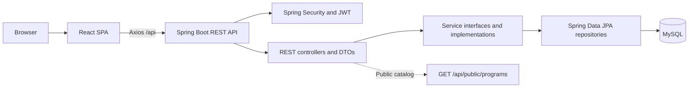

# Architecture Overview

Study Point is a monorepo with a React single-page application, a Spring Boot REST API, and a
MySQL database. Docker and Kubernetes configurations are deployment scaffolding; see the
[deployment guide](../deployment/deployment-guide.md) for current limitations.

## Layers
- Frontend: React Router pages, shared components, API services (Axios), and Redux auth state
- API presentation: Spring MVC REST controllers and request/response DTOs
- Business: Service interfaces and implementations
- Data Access: Spring Data JPA repositories
- Security: Spring Security 6 + JWT; public routes are explicitly opened

## Component Diagram



## Public Academics catalog

The public Academics page is rendered at the existing frontend route `/courses`. Its
`public-program.service.js` service requests `GET /api/public/programs`. The controller delegates
through `CourseService` to a repository query that returns only active, published courses, mapped
to a restricted public response DTO. The public page combines those fields with class-group,
medium, learning-mode, and subject metadata that are not represented in the current backend course
entity. Scholarship cards and FAQs are currently maintained in the frontend.

```text
Academics page → public-program.service.js → GET /api/public/programs
  → PublicProgramController → CourseService → CourseRepository → MySQL
```